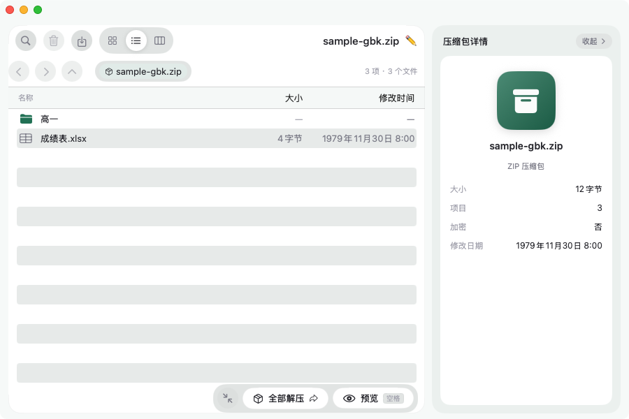
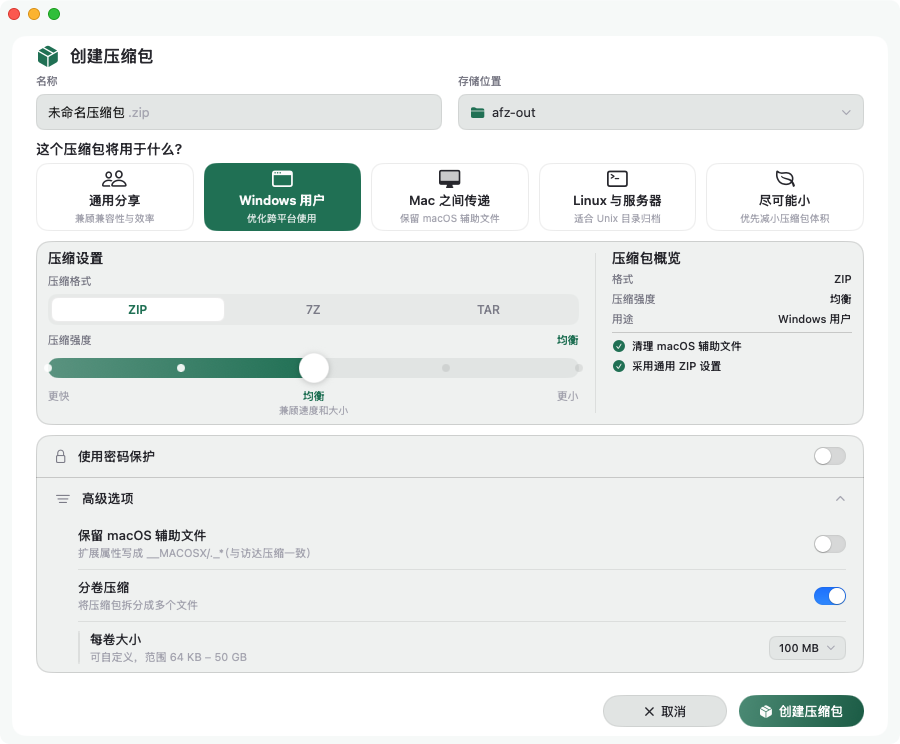
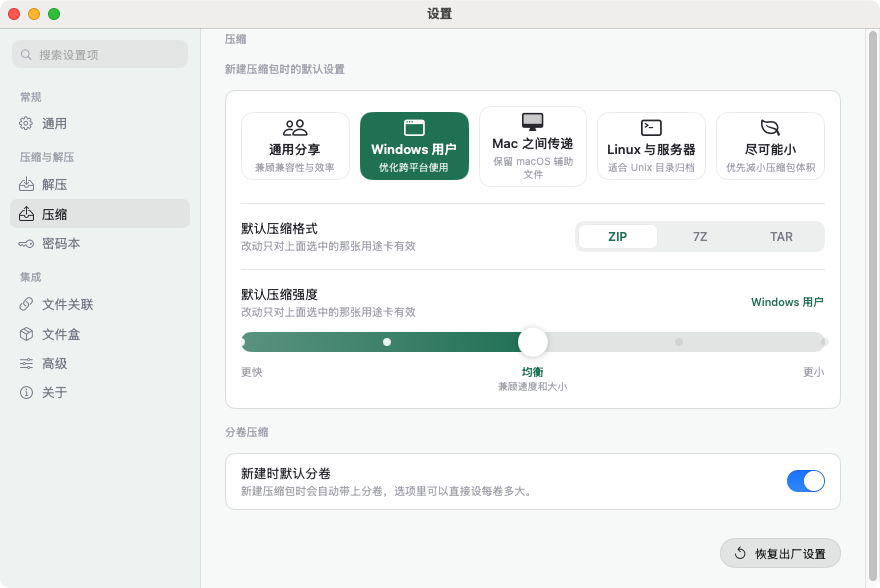
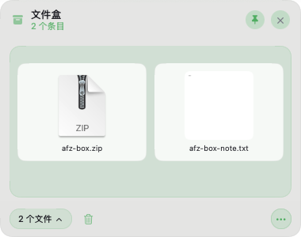

# FreeArc

一款界面精美、安全可靠的 macOS 压缩包浏览 / 解压 / 创建工具。**免费、开源、无内购**——解压和压缩是系统级的基础能力，不该被拆成付费档位。

  

| 欢迎窗 | 浏览压缩包 | 创建压缩包 | 设置 | 文件盒 |
|---|---|---|---|---|
|  |  |  |  |  |

## 为什么免费

在 macOS 上管理压缩包，本该是一件不需要付费的事。

- **不做功能墙**：压缩强度五档、分卷、密码保护、密码本、批量操作、Finder 右键菜单——全部开放，没有「专业版」按钮，也没有 7 天试用倒计时。
- **不设账号**：不登录、不激活、不联网校验。装好就能用，断网照样用。
- **数据留在本机**：密码本、偏好设置、临时产物全在本机目录内，不上传任何服务器。
- **代码可读可改**：GPL-3.0。不满意就 fork，缺什么就补什么——这是开源最朴素的意义。

极客精神不是口号，而是让使用者对自己机器上的文件与工具握有完整的支配权。

## 功能总览

### 浏览

- 打开压缩包：打开面板 / 拖放 / 双击文件关联 / 右键「用 FreeArc 浏览」
- 三种视图：图标网格 / 列表 / 分栏，切换后保持当前目录；mini 悬浮窗口支持图钉置顶与拖拽解压
- 面包屑导航、搜索过滤、⌘/⇧ 多选、全选、macOS 特有隐藏项（`.` 开头与 `__MACOSX`）一键显隐
- 嵌套压缩包：双击包内的压缩文件直接进入其内部继续浏览，可逐层返回
- 包内编辑：右键重命名 / 删除（待删态，保存统一落盘）/ ⌘Z 撤销、⇧⌘Z 重做 / 拖入添加文件
  - 编辑范围：ZIP 家族（zip / zipx / jar / apk）。加密包、分卷包与 7Z/TAR/RAR/磁盘映像保持只读（右键菜单会说明原因），避免「编辑完保存失败」或误改写容器格式
  - 拖入同名文件三选一：替换 / 同时保留 / 取消，可对整批同名项套用同一选择；新增与替换项带绿色标记
  - 保存带阶段反馈（解出原有条目 → 重新打包 → 写入原文件）；JAR/APK 含签名文件时保存前会提示签名将失效
- 右侧详情面板：格式、大小、项目数、修改日期、加密标记、整包备注（WinRAR/7z 的「备注」）

### 预览

- 空格 Quick Look：文档 / 表格 / 演示 / PDF / 图片 / 视频直接渲染真实内容
- 悬停浮动预览：缩略图卡片，视频可自动播放（默认静音，大小上限可在设置调整）
- 双击条目：与空格同一套系统预览窗口

### 解压

- 全部解压 / 解压所选（目录自动展开、剥离公共前缀，「选了什么就得到什么」）
- 单选 / 多选直接拖到 Finder：拖动行即生成文件，多选以压缩包名建文件夹
- 解压目标预检：可写性与目录创建前置检查，失败给明确原因而不是解一半报错
- 解压完成后：询问 / 保留 / 移入废纸篓（设置可选）
- 路径安全：拒绝 `../` 穿越、绝对路径与符号链接逃逸；临时产物自动清理
- 字节级进度胶囊、随时取消、完成后一键在 Finder 中显示

### 创建压缩包

- 五种目的预设：通用分享 / Windows 用户 / Mac 间传递 / Linux 与服务器 / 尽可能小
- 三种格式：ZIP（AES-256 可选）/ 7Z（固实参数随强度联动）/ TAR（bsdtar，保留 Unix 属性）
- 压缩强度五档：仅打包 / 更快 / 均衡 / 更小 / 极限；分卷 64 KB – 50 GB 自定义
- Windows 文件名兼容性检查：创建前扫描不兼容字符并批量修正
- macOS 辅助文件（`__MACOSX`、`._*`、`.DS_Store`）可保留或清理；扩展属性写 pax 头

### 加密与密码本

- 创建加密包：ZIP AES-256 / 7Z 头加密，密码框旁 🔑 菜单一键取用密码本条目
- 密码本：设置开启后集中管理密码（名称 / 备注 / 掩码显示 / 复制 / 编辑），仅存本机（0600 权限 JSON），不联网
- 打开加密包：进入锁定态浏览（黄锁），点解锁输入密码；开启「自动解锁」时用密码本条目静默尝试，命中即开并提示
- 解锁成功后询问是否保存该密码到密码本，不静默收集
- Finder 右键创建 / 解压加密包时同样可从密码本子菜单直接选用，选完即执行，不再二次弹框

### 磁盘映像（DMG / ISO）

- hdiutil 只读挂载到 Finder 不可见的临时挂载点，卸载后无残留
- 挂载校验进度可跳过；ISO / DMG 按头字节精确分流，标准 ISO 免挂载直读
- 按 `.DS_Store` 还原映像设计的图标布局与背景图，与访达打开效果一致
- 一键「安装应用」：DMG 内的 .app 先做同名冲突预检，再复制到 /Applications

### 智能推荐与文件盒

- Flow 智能推荐：按包内内容推荐此刻最合适的操作（装字体 / 装 App / 解压图片…）
- 文件盒：常驻托盘的拖放暂存区，叠加态翻页 + 逐个网格两种显示，右键 8 项动作全部真实生效，闲置自动收起，8 色外观

### Finder 集成

- 右键扩展：解压到当前 / 源文件夹 / 指定文件夹、压缩为 zip/7z、加密压缩（可选密码本条目）、浏览
- 右键解压 / 压缩以无 Dock 图标的后台形态运行，任务结束自动退出，全程不弹主窗口

## 格式支持

| 引擎 | 覆盖格式 | 说明 |
|------|----------|------|
| ZIP Foundation | `.zip .zipx .jar .apk .epub .docx .xlsx .pptx` | 原生 ZIP 解析，ZipCrypto / AES 识别 |
| 7-Zip 内核（7zz 25.01） | `.7z .rar .tar .gz .bz2 .xz .zst .lz4 .tgz .tbz2 .txz .cab .cpio .iso .wim .hfs .hfsx .apfs .lzh .arj .deb .rpm .msi` | 静态内核；RAR 受 unRAR 许可仅支持解压 |
| DMG 引擎（hdiutil） | `.dmg .sparseimage .sparsebundle .iso .cdr` | 只读挂载，临时挂载点不进访达 |

文件名编码启发式：UTF-8 标志位优先，其次 GB18030（中文 Windows 工具打包），最后 cp437 兜底——中文文件名不再乱码。

## 系统要求

- macOS 15.0 及以上
- Apple Silicon 或 Intel 芯片（可用 `--universal` 出通用二进制）

## 从源码构建

依赖：Xcode 16+（Swift 6 工具链）。ZIP Foundation 与 7-Zip 内核均已 vendor 进 `Vendor/`，**构建与测试全程离线**。

### 方式一：命令行（SPM）

```bash
# 调试构建
swift build

# 运行测试
swift test

# 一键打包 build/FreeArc.app（release，本机架构，自动签名）
scripts/make_app.sh

# 常用参数
scripts/make_app.sh --universal      # 通用二进制（arm64 + x86_64）
scripts/make_app.sh --debug          # Debug 配置
scripts/make_app.sh --install        # 构建后安装到 /Applications（访达扩展必需）
scripts/make_app.sh --no-sign        # 跳过签名
scripts/make_app.sh --sign "你的证书名称"
```

脚本默认只产出 `build/FreeArc.app`，**不会**安装到系统目录、不会重启访达；需要时用 `--install`。

### 方式二：Xcode 工程

仓库自带 `FreeArc.xcodeproj`（含 6 个 target，与 `Package.swift` 的模块划分一一对应）：

```
FreeArc               应用（嵌入扩展）
FreeArcFinderSync     访达右键扩展（appex）
ArchiveCore / FormatZip / FinderShared / ZIPFoundation   共享模块（静态库）
```

```bash
open FreeArc.xcodeproj
# 选中 FreeArc scheme，⌘R 直接运行；Product → Archive 可归档分发
```

命令行等价：

```bash
xcodebuild -project FreeArc.xcodeproj -scheme FreeArc -configuration Release build
# 产物：build/Release/FreeArc.app   （Debug 配置为 build/Debug/FreeArc.app）

# 简化写法（省略 -project/-scheme）也可以：默认构建排在第一位的 FreeArc target
xcodebuild -configuration Release build
```

工程已把 `SYMROOT` 指向仓库内的 `build/`，所以**产物直接在项目目录里**，不需要去 `~/Library/Developer/Xcode/DerivedData/…` 的长路径下翻找；Xcode 图形界面按 ⌘B 的结果也是同一位置。

> Xcode 工程与 SPM 共享同一份源码与 Info.plist，两条构建路线不会漂移；7-Zip 内核由共享脚本 `scripts/copy_7zz.sh` 拷入 Resources。
> 注意：Xcode 工程默认用 ad-hoc 签名（`CODE_SIGN_IDENTITY = "-"`），产物可本机运行，但**访达右键扩展需要真实证书**——在 Signing & Capabilities 选择 Team 后重新构建即可；或直接用 `scripts/make_app.sh`（自动匹配本机证书）。

## 签名与分发

| 签名方式 | 效果 | 适用 |
|---|---|---|
| ad-hoc（无证书默认） | 应用可用；**访达右键扩展不会出现**（PlugInKit 拒绝登记） | 本地体验 |
| Apple Development | 全功能，含右键扩展；仅本机 | 日常开发 |
| Developer ID + 公证 | 可分发给别人，过 Gatekeeper | 对外发布 |

1. **本机开发**：在 Xcode → Settings → Accounts 登录 Apple ID，工程里选 FreeArc target → Signing & Capabilities → 勾选自动签名并选择 Team；或在打包时显式指定：
   ```bash
   scripts/make_app.sh --sign "Apple Development: you@example.com (TEAMID)" --install
   ```
   安装到 /Applications 后，到 系统设置 → 扩展 → 添加到访达 勾选 FreeArc。
2. **对外分发**：
   ```bash
   scripts/make_app.sh --universal --sign "Developer ID Application: 你的名字 (TEAMID)"
   # 公证（需 App Store Connect 账号与 App 专用密码）
   ditto -c -k --keepParent build/FreeArc.app FreeArc.zip
   xcrun notarytool submit FreeArc.zip --apple-id ... --team-id ... --password ... --wait
   xcrun stapler staple build/FreeArc.app
   ```
3. **访达扩展注册纪律**：同一 bundle id 只允许 `/Applications` 里那一份被登记。对 `build/` 里的副本执行 `lsregister` / `pluginkit -a` 会导致访达渲染两份右键菜单；正式注册由应用首次启动自动完成，无需手动命令。

## 发布与更新

应用内置基于 GitHub Releases 的更新通道，不需要自建服务器。

**版本号**只有一处定义：`Sources/ArcFreeZip/AppUpdate.swift` 的 `AppUpdate.currentVersion`。打包脚本会自动把它写进 `Info.plist` 的 `CFBundleShortVersionString`，两者永远一致。

**出发布包**：

```bash
scripts/make_release.sh                # 本机架构
scripts/make_release.sh --universal    # Apple 芯片 + Intel（需要能交叉编译）
scripts/make_release.sh --package-only # 不编译，直接打包现有 build/FreeArc.app
scripts/make_release.sh --publish      # 出包后直接创建 GitHub Release
```

脚本会编译、校验签名、生成 `dist/FreeArc-<版本>.zip`（内部根目录就是 `FreeArc.app`），并打印架构、tag 名、大小与 SHA256。

**出通用二进制**：`--universal` 依赖 SPM 交叉编译，个别环境会在宏插件处失败（脚本会回退本机架构并告警）。这时用 Xcode：打开 `FreeArc.xcodeproj` → 目标选 *Any Mac (Apple Silicon, Intel)* → Product → Archive，再从 Organizer 的 *Distribute App → Copy App* 导出 `FreeArc.app`，放进 `build/`，然后：

```bash
scripts/make_release.sh --package-only --universal
```

`--package-only` 只做「校验版本 + 校验签名 + 打包 + 打印 SHA256」，不会覆盖你手动编出来的通用包。

**写发布说明**：正文手写，放在 `ReleaseNotes/<版本>.md`（例：`ReleaseNotes/1.2.0.md`），会原样成为 Release body，也就是用户更新弹窗里读到的那段文字。缺文件时脚本会按提交记录生成草稿并提醒补充。

写的时候注意两点：更新弹窗是纯文本视图（不渲染 Markdown），普通段落加 `-` 列表最稳，`##`、`**` 会原样显示成符号；不用在说明里手抄大小和 SHA256——脚本会自动把「安装包（架构、大小）」与 `SHA256` 追加到 `dist/FreeArc-<版本>-notes.md` 末尾，校验值永远抄不错。

**发 Release**：一条命令，或网页手动。约定三条：

| 项 | 要求 |
|---|---|
| Tag | `v1.2.0` 形式，严格三段语义化版本；程序用它和本地版本比较 |
| Asset | `FreeArc-1.2.0.zip`，文件名必须和版本对应（更新器优先精确匹配，退而匹配名字含 freearc 的 .zip） |
| 说明 | `ReleaseNotes/<版本>.md`，脚本拼好校验信息后写到 `dist/FreeArc-<版本>-notes.md` |

```bash
scripts/make_release.sh --package-only --publish   # 需要 gh 已安装并登录
# 等价于：
gh release create v1.2.0 dist/FreeArc-1.2.0.zip \
    --title "FreeArc 1.2.0" --notes-file dist/FreeArc-1.2.0-notes.md
```

`--publish` 动手前先确认三件事：`gh` 已登录、本地提交已推送（Release 指向远程 HEAD）、远端还没有同名 tag。

不要勾选 *Pre-release* 或保持 *Draft*——`releases/latest` 接口会跳过它们，客户端永远看不到。

**更新器行为**：启动 10 秒后静默检查（24 小时内最多一次，用 ETag 省 API 配额）；发现新版弹「下载并更新 / 跳过此版本 / 稍后」，跳过会持久化不再打扰；下载显示进度、可取消；安装是「清 quarantine → 解压 → staging 两段式替换当前应用 → 拉起新实例 → 旧实例退出」，失败按阶段提示原因。设置 → 通用「更新」卡可关闭自动检查、手动检查；后台任务形态（`-afz-background`）不联网。

**升级包来源必须是完整签名**：ad-hoc 签名的包自己更新自己没问题（quarantine 由更新器清除），但对外分发建议 Developer ID + 公证，否则用户首次手动打开会被 Gatekeeper 拦。

## 常见问题

**Q：访达右键菜单里没有 FreeArc？**
三步排查：① 应用是否放在 `/Applications` 且用真实证书签名（ad-hoc 下扩展不会登记，见上表）；② 系统设置 → 登录项与扩展 → 添加到访达 里是否勾选了 FreeArcFinderSync；③ 重新勾选一次扩展开关，或注销重登。

**Q：应用双击后闪退 / 启动即崩？**
优先怀疑**签名失效**。终端执行 `codesign -vv /Applications/FreeArc.app`，若报 `invalid Info.plist` 说明包内文件在签名后被改动过（例如手动编辑过 Info.plist、或用了旧版工具链打包）。重新用 `scripts/make_app.sh` 打包覆盖即可；应用自身不会修改包内任何文件。

**Q：加密压缩包的密码能记住吗？**
能。设置 → 密码本 里开启后即可管理密码条目；创建/解压时可从密码本选用，解锁成功后应用会**询问**是否保存（不会偷偷记下）。所有密码只存在本机（`~/Library/Application Support/FreeArc/password-book.json`，0600 权限），不上传任何服务器。

**Q：RAR 可以压缩吗？**
不行。RAR 压缩算法有专利授权限制，7zz 内核只提供 RAR 解压能力。压缩请用 ZIP / 7Z / TAR，其中 7Z 的压缩比与 RAR 相当。

**Q：双击 DMG / ISO 会挂载吗？**
DMG 走系统 `hdiutil` 挂载，ISO 先由内置解析器直接读取（免挂载）；挂载类操作在系统层面完成，与访达双击行为一致。

**Q：为什么解压出来多了一层文件夹？**
对「包内只有一个根文件夹」的压缩包，解压时直接沿用该文件夹名（不再额外套一层）；包内是散文件时才以压缩包文件名建目录收纳。这与访达「解压缩」的直觉一致，可避免 `test → test 2` 这类重复目录。

## 工程结构

```
Sources/
  ArcFreeZip            应用层（SwiftUI 工作区、三视图、设置、文件盒、任务编排）
  ArchiveCore           引擎协议与模型（ArchiveReading / ArchiveEntry / 引擎路由）
  FormatZip             各格式引擎（ZIP / 7zz / DMG / 写入器）
  FinderShared          右键任务执行层（扩展与主程序共用，行为完全一致）
  FreeArcFinderSync     访达扩展进程入口
Vendor/
  ZIPFoundation         MIT，本地 vendoring
  7zz                   7-Zip 官方静态内核，LGPL-3.0 + unRAR 限制
Resources/              Info.plist、扩展 plist、entitlements、icns
assets/screenshots/     README 用的界面截图
Samples/                手动测试用样本包（GBK 文件名、多层目录）
ReleaseNotes/           每个版本的发布说明（= 更新弹窗正文），按版本号命名
scripts/                make_app.sh 打包 / make_release.sh 出发布包 / make_icon.sh 图标 / copy_7zz.sh 内核拷贝
tools/                  icongen（与 App 共用 IconArtwork 生成 icns）
FreeArc.xcodeproj       Xcode 工程（与 Package.swift 同构）
```

## 许可

- 本项目主体：GPL-3.0（见 `LICENSE`）
- `Vendor/ZIPFoundation`：MIT（见 `Vendor/ZIPFoundation/LICENSE`）
- `Vendor/7zz`：7-Zip 官方内核，LGPL-3.0 + BSD + unRAR 限制条款（见 `Vendor/7zz/License.txt`）。RAR 仅支持解压，不含压缩实现。

## 贡献

欢迎 Issue 与 PR。提交前请确保 `swift test` 全部通过，并遵循现有代码风格（Swift API Design Guidelines）。
